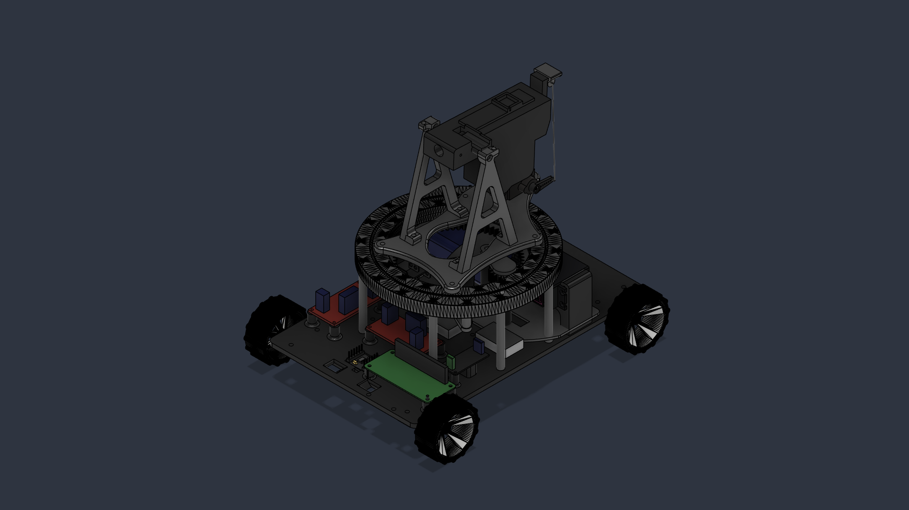
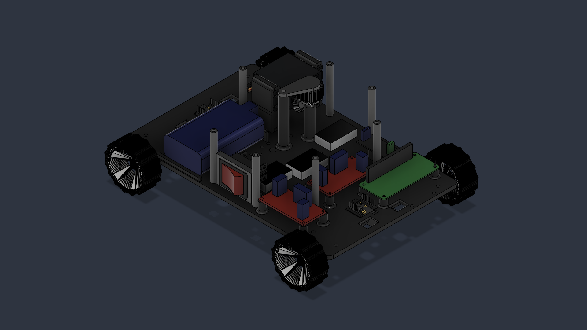
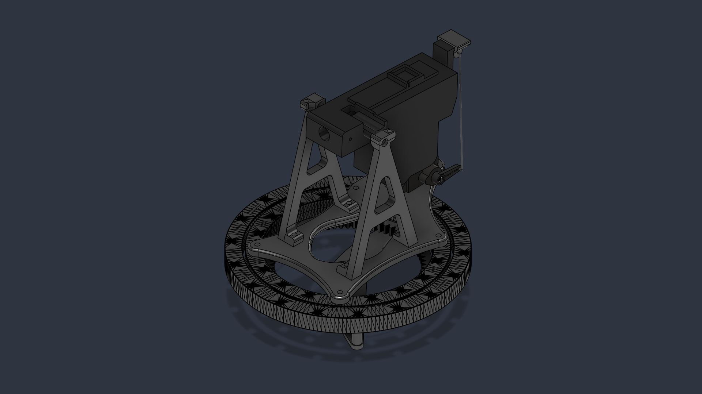
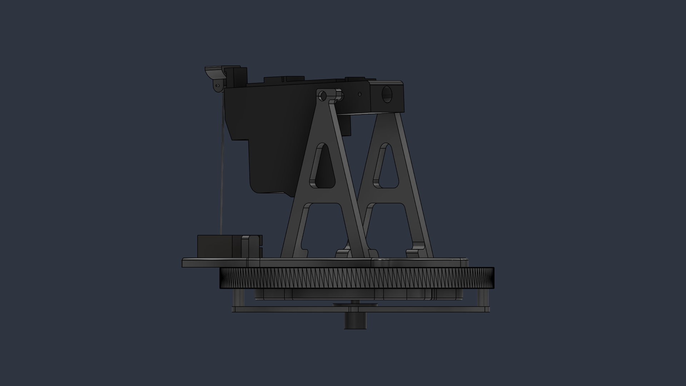

# 🤖 Mecanum Battle Robot

[](https://www.python.org/)
[](https://www.raspberrypi.com/)
[](LICENSE)

Remote-controlled combat robot featuring omnidirectional Mecanum drive, 360° continuous turret rotation, active BB firing mechanism, and isolated dual-power rail architecture.

---

## 📸 Media & Demo

> *Main foto*


---

## ✨ Key Features

* **Omnidirectional Movement:** Powered by 4x Mecanum wheels driven by dual DRV8833 motor drivers.
* **360° Continuous Turret Rotation:** Endless rotation enabled by a 12-channel (2A/ch) slip ring assembly.
* **Active Firing System:** Taigen BB cannon mechanism driven by a dedicated MOSFET switch with cut-off end-stop sensor feedback.
* **Asynchronous Control Architecture:** Non-blocking Python implementation utilizing `asyncio` and `gpiozero` for smooth parallel execution (driving, aiming, and firing).
* **Robust Power Isolation:** Dual XL4015 Buck converters separating sensitive digital logic (RPi) from high-current mechanical spikes (Servos & Motors).
* **Custom 3D Printed Chassis:** Engineered with PLA (Gyroid infill, multi-perimeter walls) with integrated KCD4 power switches and modular mounts.

---

## 🛠️ Hardware Architecture


### Power Supply Distribution
To ensure system stability and avoid brownouts during high motor loads or piston recycles, the power system is divided into two main isolated rails downstream of the **2S Li-ion battery pack (7.4V)** and **BMS board**:

1. **Logic Rail:** XL4015 Step-Down → **5V** dedicated exclusively to the Raspberry Pi.
2. **Actuator Rail:** XL4015 Step-Down → **5V** powering the turret pan/tilt servomotors and targeting laser.
3. **High-Power Direct Rail:** **7.4V Direct (Switch)** driving the Taigen firing mechanism via MOSFET switch and DC motors via DRV8833 drivers.

```
                  [ 2S Li-Ion Battery Pack (7.4V) ]
                                 │
                           [ Main Switch ]
                                 │
     ┌───────────────────────────┼───────────────────────────┐
     ▼                           ▼                           ▼
[ XL4015 Buck #1 ]       [ XL4015 Buck #2 ]           [ Direct 7.4V Rail ]
     │                           │                           │
     ▼ (5V)                      ▼ (5V)                      ├─► DRV8833 Motor Drivers
Raspberry Pi               Servos & Laser                    │
                                                             └─► MOSFET (Taigen Cannon)
```

---

## 📊 Bill of Materials (BOM)

| Component | Description | Qty |
| :--- | :--- | :---: |
| **Raspberry Pi** | Main controller board | 1 |
| **DRV8833** | Dual H-Bridge motor driver | 2 |
| **XL4015 Step-Down** | 5A Buck converter with heat sink | 2 |
| **2S Li-ion (18650)** | Main power pack (7.4V - 8.4V) | 1 |
| **12-Channel Slip Ring** | 12.5mm outer diameter, 2A/channel (360° turret) | 1 |
| **Taigen Airsoft Mechanism** | BB cannon mechanism with end-stop switch | 1 |
| **MG996R Servo** | High-torque servo (Turret Pan) | 1 |
| **MG90S Servo** | Micro metal-gear servo (Strikeline / Elevation) | 1 |
| **IRF520 / AOD4184** | MOSFET module for firing control | 1 |

---

## 📁 Project Structure

```text
.
├── docs/                      # Schematics, circuit diagrams, and hardware documentation
│   ├── mechanical/            # CAD models & STL files for 3D printing
│   ├── schematics/            # Electrical wiring diagrams (Cirkit Designer exports)
│
├── media/                     # Project showcase media for GitHub
│
├── core/                      # Main software application logic
│   └── robot_logic.py         # High-level state machine & module coordinator
│
├── hardware/                  # Hardware module-based abstraction layer (gpiozero / asyncio)
│   ├── drivetrain.py          # Mecanum wheel kinematics & dual DRV8833 control
│   ├── gun.py                 # Async Taigen cannon firing mechanism & limit sensor
│   ├── lights.py              # LED indicator and illumination drivers
│   ├── turret.py              # Pan/tilt turret control (continuous & positional servos)
│   └── turret_legacy.py       # Legacy turret controller (backup implementation)
│
├── inputs/                    # Remote control & signal parser modules
│   ├── crsf_parser.py         # ExpressLRS / CRSF protocol packet parser
│   ├── elrs_input.py          # ELRS RC link input mapping
│   └── xbox_controller.py     # Bluetooth Xbox Gamepad mapping module
│
├── config.py                  # Global GPIO pin assignments and timing constants
├── main.py                    # Application entry point (Asyncio event loop runner)
├── requirements.txt           # Python dependencies (gpiozero, RPi.GPIO, etc.)
│
├── .gitignore                 # Excluded files (pycache, virtual environments)
├── LICENSE                    # Software licensing terms (e.g., MIT License)
└── README.md                  # Primary repository overview and showcase documentation
```

---

## 📄 3D Printed Chassis & Hardware Design

The physical chassis and mechanical components were designed in **Autodesk Fusion 360** and printed on a **BambuLab P1S** using **PLA** for rigid structural elements and **TPU**.

---

### 🛠️ Subsystem Assemblies

### Complete Assembly



Assembled combat robot featuring continuous turret movement. Custom PLA chassis printed with a 5 mm baseplate, featuring an integrated 360° slipring and dual-rail power separation.

---

### Lower Chassis & Electronics




Raspberry Pi main computer powered via a dedicated clean XL4015 buck converter. Features dual DRV8833 motor drivers for the 4-wheel Mecanum drive and an independent XL4015 power rail for the high-load Pan servo (MG996R).

---

### Turret & Upper Bearing Assembly





Continuous 360° rotation enabled by a 12-channel 12.5mm slipring. Houses the integrated Taigen BB cannon mechanism with MOSFET high-side/low-side drive, a hardware limit-switch endstop for automatic piston stroke cut-off, and tilt adjustment via an MG90S metal-gear servo.

## 📝 License

This project is licensed under the MIT License - see the [LICENSE](LICENSE) file for details.
